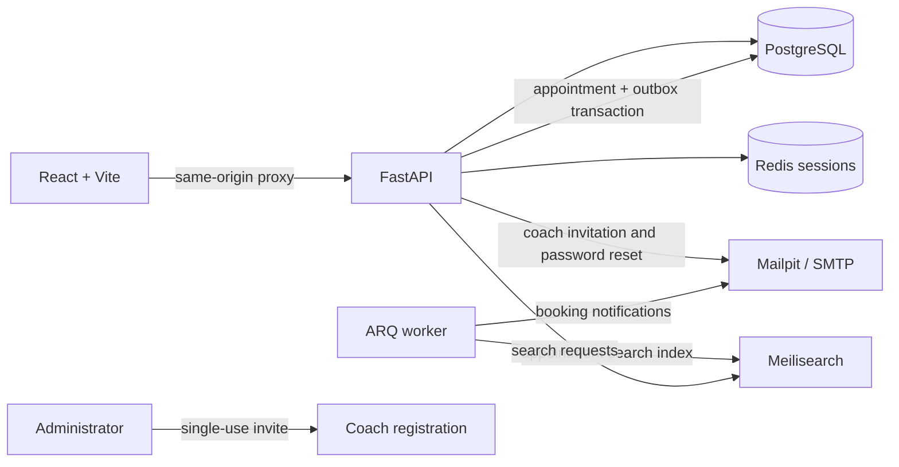

# System architecture

## Runtime shape

The system is a modular monolith. The local application includes a React/Vite staff portal, FastAPI authentication and scheduling APIs, PostgreSQL, Redis-backed sessions, and an ARQ notification worker. Vite proxies `/api`, `/docs`, `/openapi.json`, and `/health` to FastAPI so browser requests stay same-origin.

## Backend and frontend

The backend uses SQLAlchemy's async API with `asyncpg`. The FastAPI app registers the Redis-session authentication routes, administrator coach-account routes, and scheduling routes under `/api/v1`. Alembic revisions `0001` through `0003_scheduling` create user, token, availability, student, appointment, and outbox tables. Revision `0004_booking_notifications` adds per-recipient delivery history and saved academy booking settings. Revision `0005_appointment_reasons` stores cancellation and rescheduling reasons on each appointment. Revision `0006_country_codes` stores coach and student country codes. Revision `0007_meeting_links_student_erasure` adds coach defaults, and `0008_student_delete_history` supports deleting student rows while preserving redacted booking history.

Local Compose runs migrations before the API starts. Production runs migrations as a release step before deployment. `/health/live` reports process liveness; `/health/ready` checks PostgreSQL and Redis connectivity. The API does not create tables at runtime.

The frontend uses Redux Toolkit for the app store and one RTK Query cache for authentication, coach accounts, appointments, availability, students, dashboard data, and academy settings. Tailwind CSS styles custom React UI components; the project does not use DaisyUI or shadcn/ui. TypeScript type checking and Vite production builds use the same Vite TypeScript config.

## Booking and availability

Admins book a coach with student or parent contact details. Coach availability is stored as weekly local-time rules plus date-specific exceptions. Coach registration, profiles, booking, and availability editing ask for a country and a region-based IANA time zone. The selected region carries its daylight-saving rules; nonexistent spring-forward wall times and repeated fall-back times are handled explicitly. Slot generation subtracts existing confirmed bookings and limits a search to 90 days. Academy settings control demo duration, start-time interval, and buffers.

PostgreSQL stores the booking, student contact, coach meeting-link snapshot, and outbox event in one transaction. A GiST exclusion constraint prevents overlapping confirmed bookings for a coach, including concurrent requests. An idempotency key makes retried booking requests safe. Reschedule and cancellation operations save the required reason and write their notification event in the same transaction as the appointment change. Ended confirmed demos can be marked completed. Inactive coaches cannot be booked, and their active sessions are revoked during deactivation.

## Notifications and meeting details

The ARQ worker claims outbox rows with database row locks, sends messages to the coach, booking administrator, and student contact, and records each recipient's delivery status and attempt count. Retries skip messages already accepted by SMTP. Booking emails omit instructor-only notes. Coach invitations and password resets use the same SMTP settings and are emailed immediately while their one-time links remain available to the admin for private sharing. Local SMTP is provided by Mailpit at `http://localhost:8025`, which captures email without sending it to real inboxes. Production uses an SMTP server configured through environment variables.

The appointments search page debounces input for 300 ms and sends queries of at least two characters to the backend. The backend applies role and status filters before returning hydrated PostgreSQL records in Meilisearch rank order. The worker creates the `appointments` index, rebuilds it from existing records at startup, and consumes transactional outbox events for bookings, cancellations, reschedules, coach-name changes, student deletion, and appointment status changes. The Meilisearch master key stays server-side. Coach password-reset requests use a generic response and rate limits to avoid account discovery and email abuse.

Coaches can keep a default HTTPS meeting URL in their profile. The booking form copies that URL, and admins can change or clear it per appointment. Booking notifications include the saved link. The app does not provision meetings or calendar events through a provider API.

## Security and operations

Sessions are random opaque values stored in Redis. State-changing authenticated requests require the matching CSRF cookie and header. Session cookies are marked Secure in production. Failed sign-ins are throttled in Redis by source IP and a keyed hash of the normalized account address; successful credentials can recover an account-level throttle. API routes enforce roles and coach ownership on the server. Logs contain request metadata, not student details or request bodies.

Development Compose uses PostgreSQL, Redis, Meilisearch, Mailpit, the API, worker, and Vite. Production Compose expects managed PostgreSQL, Redis, and Meilisearch, HTTPS at an external reverse proxy, SMTP, and secret injection. Production calendars request only the visible date interval; list responses eager-load coach and student records in bounded queries. Backups, restoration, and student retention policy remain deployment responsibilities. After future bookings are cancelled or rescheduled, student deletion removes the student row and contact details; old appointments remain with a null student reference and no student notes or change reasons.
